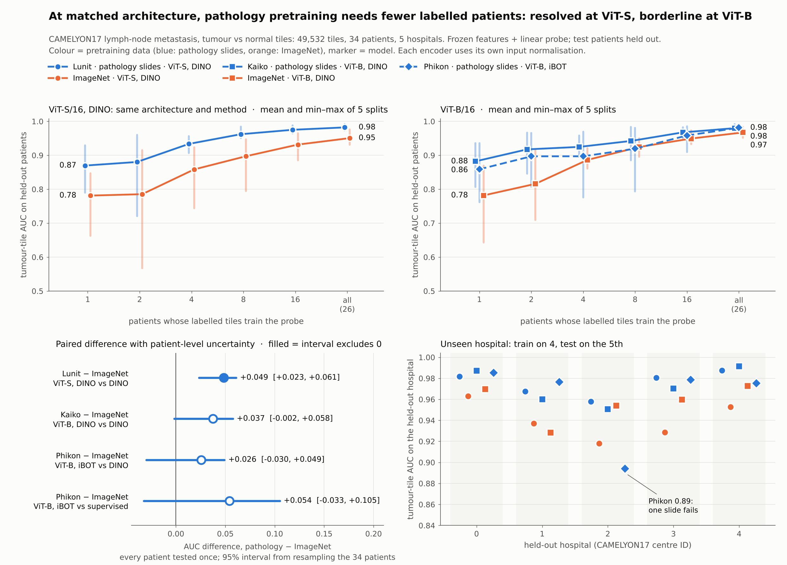
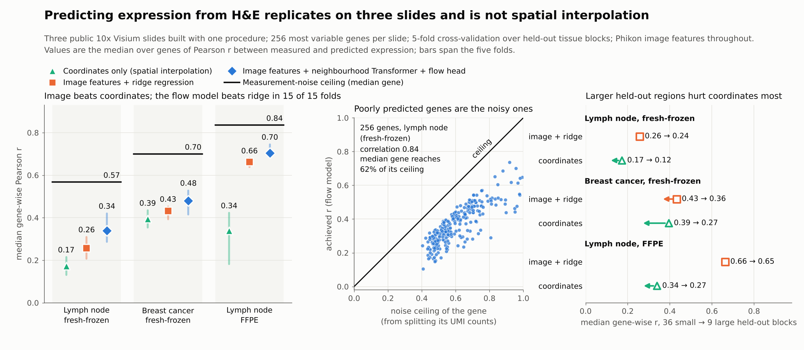
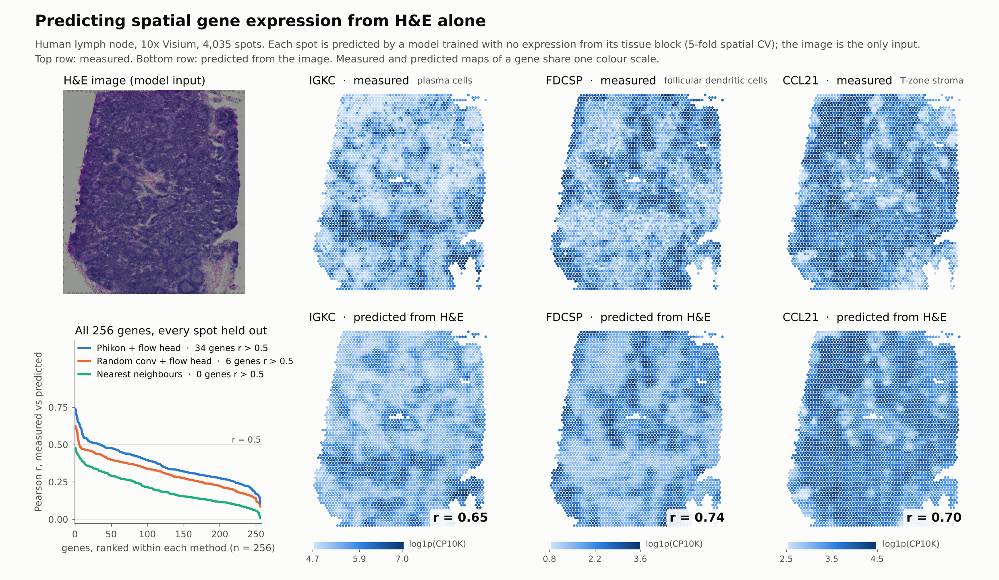
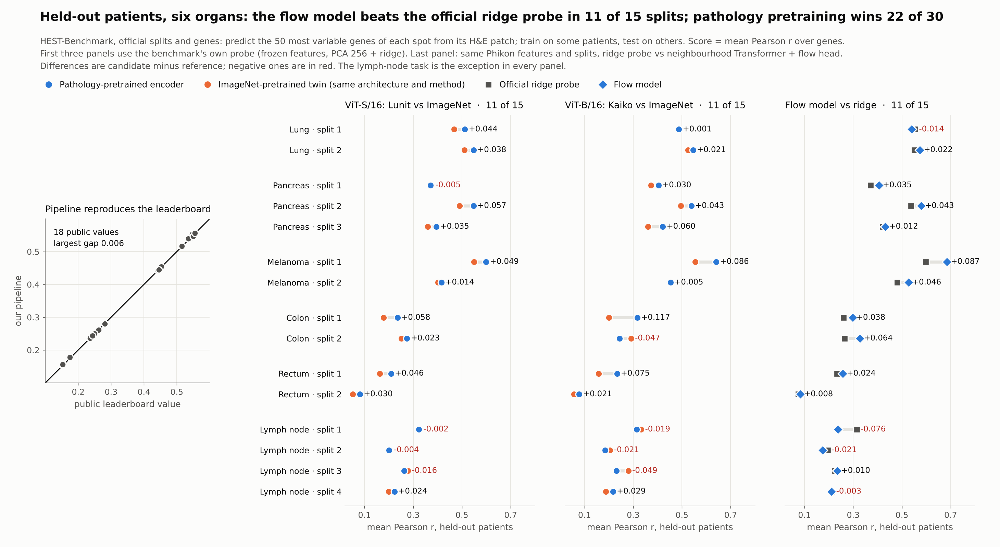
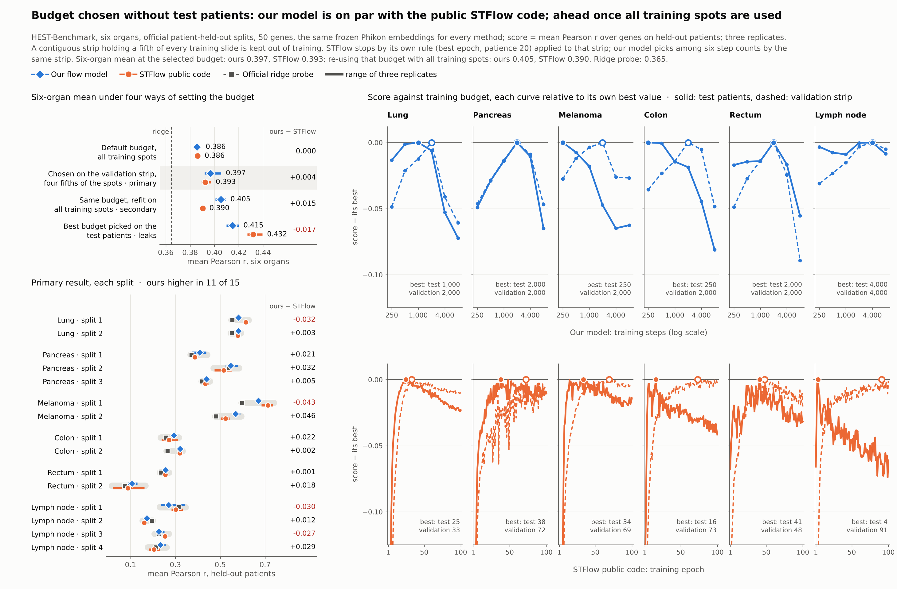
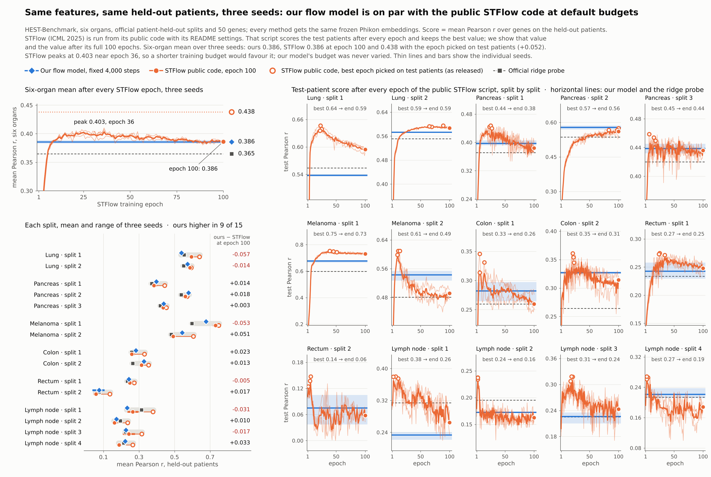

# Update, November 2026: what holds across patients, organs and a published method

Four additions to the pathology half, and one update to its ImageNet baseline. Every rule that
decides a claim was written down before the run that tests it
([`PREREG.md`](PREREG.md)), and every new pipeline first had to reproduce a
number that already existed.

| question | answer | where |
|---|---|---|
| Does pathology pretraining help once architecture and method are held fixed? | **+0.049 AUC** over the ImageNet twin, 95% CI [+0.023, +0.061], all 5 held-out hospitals | [1](#1-camelyon17-pretraining-data-at-matched-architecture) |
| Is expression predicted from H&E more than spatial interpolation? | image beats a coordinates-only baseline in **15 of 15** folds; the median gene reaches 62–86% of its noise ceiling | [2](#2-expression-from-he-within-a-slide-three-slides) |
| Does it carry to patients never seen? | **+0.040** mean Pearson over the benchmark's ridge probe, 13 of 15 splits, 5 of 6 organs | [3](#3-held-out-patients-hest-benchmark-six-organs) |
| How does it compare with a published method on identical inputs? | **0.397 vs 0.393** against the public STFlow code: parity under a pre-registered rule | [4](#4-head-to-head-with-the-public-stflow-code) |
| How strong is the ImageNet baseline with its own input statistics? | 0.891 patient-held-out AUC on BreaKHis, not 0.801; "ImageNet contributes nothing" does not hold | [5](#5-update-input-statistics-of-the-imagenet-baseline) |

---

## 1. CAMELYON17: pretraining data at matched architecture

49,532 tumour/normal tiles, 39 slides, 34 patients, 5 hospitals. Frozen features, the linear
probe of `src/audit.py`, patients held out. The comparison that isolates the
pretraining data is the one where nothing else changes: ViT-S/16 trained with
DINO on pathology slides (Lunit) against the same architecture and method trained
on ImageNet.



| contrast (pathology − ImageNet) | AUC difference | 95% CI, 34 patients resampled | verdict |
|---|---|---|---|
| Lunit − ImageNet, ViT-S/16, DINO vs DINO | **+0.0485** | [+0.0234, +0.0610] | resolved; higher in 5 of 5 held-out hospitals |
| Kaiko − ImageNet, ViT-B/16, DINO vs DINO | +0.0375 | [−0.0016, +0.0576] | borderline: interval touches zero |
| Phikon − ImageNet, ViT-B/16, iBOT vs DINO | +0.0257 | [−0.0300, +0.0491] | unresolved |

With labelled tiles from one training patient the Lunit encoder reaches 0.870 AUC
and its ImageNet twin 0.781; with all patients, 0.982 and 0.951.

Two things did **not** work and are reported as such. The pre-registered combined
claim ("helps at both sizes") is false, because the ViT-B interval includes zero.
And Phikon's worst held-out hospital is 0.894 because of a single slide
(`patient_052_node_1`, montage in
[`figures/c17_failure_patient_052_node_1.png`](figures/c17_failure_patient_052_node_1.png))
on which two other pathology encoders score 0.94–0.98; three pre-registered
hospital-shift fixes made it worse, not better.

## 2. Expression from H&E within a slide: three slides

The earlier cross-modal result was one slide of one tissue. This repeats it with
one procedure on three public 10x Visium slides (two lymph nodes, one breast
cancer; fresh-frozen and FFPE), 256 most variable genes each, 5-fold
cross-validation over held-out tissue blocks, Phikon features, prediction from
the image alone.



| slide | coordinates only | image + ridge | image + flow model | noise ceiling | genes with r > 0.5 |
|---|---|---|---|---|---|
| lymph node, fresh-frozen | 0.17 | 0.26 | **0.34** | 0.57 | 34 of 256 |
| breast cancer, fresh-frozen | 0.39 | 0.43 | **0.48** | 0.70 | 103 of 256 |
| lymph node, FFPE | 0.34 | 0.66 | **0.70** | 0.84 | 250 of 256 |

Values are the median over genes of Pearson r between measured and predicted
expression. The coordinates-only baseline is what pure spatial interpolation
buys; the noise ceiling is estimated per gene by splitting its UMI counts. The
flow model is above ridge in 15 of 15 folds and above coordinates in 15 of 15.
Its 90% intervals cover 89–93% before and 89–90% after split-conformal
calibration.



How this sits next to section 4 of the main README: that section measures what
morphology adds **when the neighbours' expression is already measured** (very
little: 0.005 CRPS). This one measures prediction **when no expression is
measured at all**, which is the situation on a new slide.

## 3. Held-out patients: HEST-Benchmark, six organs

Official patient-held-out splits and gene lists (lung, pancreas, melanoma, colon,
rectum, lymph node; 15 splits). The pipeline first reproduced 18 values of the
public leaderboard, with a largest gap of 0.006.



The figure is the first pass: one seed at the default training budget, where the
flow model is above ridge in 11 of 15 splits. The table below is the final
reading. Against the benchmark's own probe (PCA 256 + ridge) on the same Phikon features,
with the training budget of the model chosen on a strip of the training slides
(section 4):

| | ridge probe | flow model | difference |
|---|---|---|---|
| six-organ mean Pearson r | 0.365 | **0.405** | **+0.040** |
| splits where the flow model is higher | | | 13 of 15 |
| organs where it is higher | | | 5 of 6 |

The lymph-node task is the exception, for this model and for STFlow alike. The
matched-pretraining comparison of section 1 also repeats here: the pathology
encoder beats its ImageNet twin in 22 of 30 split-by-pair comparisons, again with
lymph node as the exception (2 of 8).

## 4. Head-to-head with the public STFlow code

STFlow (ICML 2025) is the closest published method: flow matching with spatial
context. Its public code was run on the same frozen Phikon embeddings and the
same official splits, three seeds each.

The released training script evaluates the **test** patients after every epoch
and keeps the best value. So three ways of setting the training budget are
separated here, and only the middle two decide the comparison:



| how the budget is set | flow model | STFlow public code | difference |
|---|---|---|---|
| each method's default | 0.386 | 0.386 | 0.000 |
| **chosen on a validation strip of the training slides (pre-registered primary)** | **0.397** | **0.393** | **+0.004 → parity** |
| the selected budget, refit on all training spots (secondary) | 0.405 | 0.390 | +0.015 |
| best budget picked on the test patients (leaks; shown for scale) | 0.415 | 0.432 | −0.017 |

The reading rule was fixed in advance: parity if the six-organ means differ by
less than 0.01. On the primary line the flow model is higher in 11 of 15 splits
but the replicates overlap; on the secondary line it is higher in all nine
replicate pairings. Picking the budget on the test patients inflates the
reported score by 0.02–0.04, and it favours the method that chooses among 100
epochs over the one that chooses among 6 step counts.



What this does **not** show: that the flow model beats STFlow (the primary
reading is parity); anything about STFlow's published numbers, which use UNI
features; or that the validation strip is a good proxy for new patients — it
comes from the training patients and prefers longer training than is best for
unseen ones. The public STFlow code needed a one-line repair to start
([`stflow_cmp/patch_model.py`](stflow_cmp/patch_model.py)) and its authors
describe it as a demo.

## 5. Update: input statistics of the ImageNet baseline

`src/bench.py`, `src/c17bench.py`, `src/c17site.py` and `src/xmodal.py` normalised
every encoder's input with the ImageNet mean and standard deviation. The
ImageNet ViT-S used as the baseline (`augreg_in21k_ft_in1k`) expects 0.5 / 0.5.
The mismatch raises no error. The code now reads the statistics
from each checkpoint's own configuration; the as-released code was first rerun to
confirm it reproduces the published row, then rerun with the change
([`rerun_imagenet_rows.sh`](rerun_imagenet_rows.sh)).

| BreaKHis, ImageNet ViT-S/16 | random | patient (honest) | magnification shift | leak |
|---|---|---|---|---|
| first published (ImageNet input statistics) | 0.951 | 0.801 | 0.766 | +0.150 |
| **current (the checkpoint's own statistics)** | **0.958** | **0.891** | **0.916** | **+0.067** |

Consequences, applied to the main README: "a colour histogram matches ImageNet"
does not hold (0.794 against 0.891); on BreaKHis, Phikon's margin over ImageNet
shrinks to 0.011, inside the ±0.02–0.03 resolution of that benchmark; the leak
range becomes 0.067–0.106. Section 0, the verified table, compares raw-pixel and
Phikon only and is unaffected. On the CAMELYON17 tile set of section 1 the same
change moves the ImageNet ViT-S from 0.935 to 0.952.

Two other ImageNet rows of the main README are affected. The cross-modal one
barely moves (morphology-kNN r +0.0994 → +0.0873 at 59 µm, +0.1121 → +0.1111 at
138 µm; CRPS within the ±0.002 run-to-run variation) and is updated in place.
The whole-slide CAMELYON17 one was computed on a tile snapshot that is no longer
at hand; it is marked as understated there and has not been rerun.

---

## Layout

```
PREREG.md               every decision rule, written before the run it governs; results appended
xmodal_v2.py            the model: neighbourhood Transformer + rectified-flow head, with held-out
                        expression kept out of context and targets (the revision of src/xmodal.py)
c17_*.py                section 1: encoder grid, probes, patient bootstrap, failure-slide montage
st_*.py                 section 2: one build procedure for three slides, controls, noise ceiling, conformal
hest/                   section 3: benchmark download, embeddings, official ridge, flow model, budget selection
stflow_cmp/             section 4: environment, patches to the public code, run scripts, summaries
fig_*.py                the figures, from the result files
results/                the result files behind every number above (JSON)
rerun_imagenet_rows.sh  section 5
```

Scripts write next to themselves and expect to be run from their own folder.
`PFM_DATA` overrides where public inputs are read from (default
`pathology-fm/data`), `C17_TILESET` the CAMELYON17 tile set, `PYTHON` the
interpreter used by the shell scripts.

## What you need to rerun it

- **Sections 3–4** are self-contained: `hest/hest_download.py` fetches the
  benchmark (the dataset is gated on Hugging Face; accept its terms first),
  then `hest_embed.py`, `hest_ridge.py`, `hest_flow.py`, `hest_flow_val.py`.
  For STFlow: `stflow_cmp/setup_env.sh` clones the public code at commit
  `880c2ee`, the three `patch_*.py` scripts and `make_train_val.py` apply the
  documented changes, `run_h2h.sh`, `run_h2h_seeds.sh` and `run_val.sh` run it.
- **Section 2** needs three public 10x Visium downloads in `data/raw_10x/`
  (V1 Human Lymph Node, V1 Breast Cancer Block A Section 1, Visium V2 Human
  Lymph Node FFPE: count matrix, full-resolution image, `spatial.tar.gz`).
- **Section 1** needs a CAMELYON17 tile set: one `.npz` per slide with
  `patches`, `labels`, `patient_id`, `grade`, `centre`. The set used here
  (55 slides, 39 after the ITC slides are dropped) comes from a later revision
  of `src/wsi.py` than the one in this repository, so this section is
  reproducible in method but not yet turnkey. `PREREG.md` also names
  `st_cv.py`, the first single-slide version of the cross-validation; its fold
  rule is the one in `st_eval.py`.

## Limits, stated plainly

- Parity with STFlow is parity with its **public code on Phikon features**. The
  comparison with its published UNI numbers has not been made.
- The model is an independent implementation of an existing idea (flow matching
  with spatial context), not a new method class.
- Calibrated uncertainty holds within a slide. Across patients the predictive
  distributions beat a no-skill reference in only 4 of 15 splits.
- The lymph-node benchmark task is not solved by either flow model.
- Three within-slide results are three slides. Six organs are 19 slides.
- On the FFPE lymph node the first principal component of expression carries 38%
  of the variance and tracks library size; its high scores partly reflect that.
